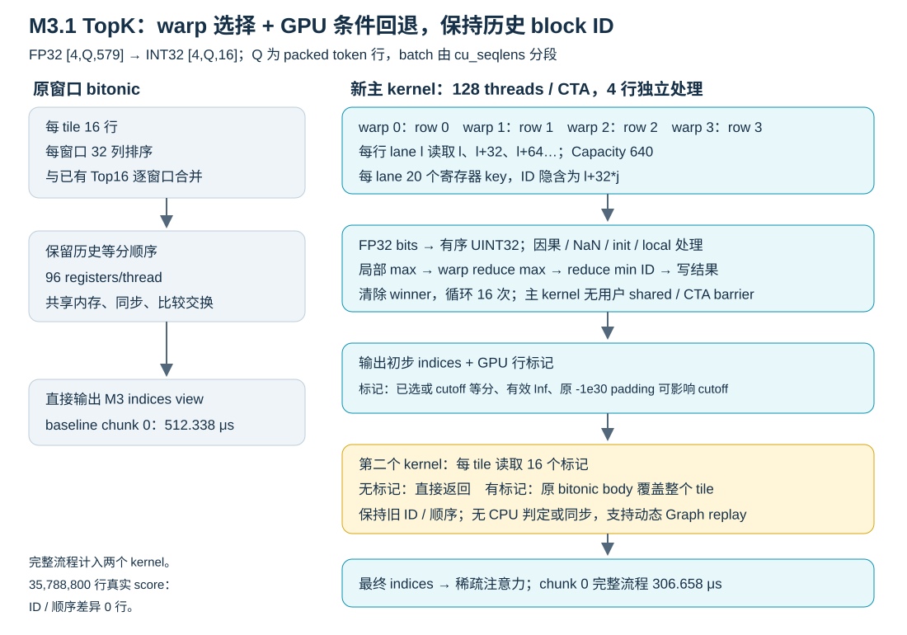

# MiniMax-M3.1 Prefill 优化与验证

合并原Prefill分析、CP suffix wire说明、生产审查及Warp TopK报告/逐行审查。保留方案、关键结果和未完成项，移除历史调优流水账。结果是各次冻结实验记录，本次文档整理未重跑。

## 范围与数据流

模型60层全部MSA，前三层dense FFN、后57层MoE。CP4前缀pack/AllGather/restore与同层projection/norm有重叠，下一层prefetch保持关闭；Zero-CTA使用CE copy，不能以NCCL kernel计数判断通信消失。

主FI路径读BF16 Q与打包KV4，选中tile在片上反量化BF16做MMA/softmax，没有全历史BF16扩张。index score/TopK与MoE专家选择、输出采样属于不同算子。BS20/74011/reuse66560与BS60/80000/reuse75776不可混为同契约A/B。

## CP4 优化方案与模型结论

固定五场景：纯Prefill BS40/60、BS60→40收缩，自然PD BS40/60；80000输入、75776复用。主证据目录 `/data0/ruixuan.zrx/minimax-m31-dev/1009_prefill_model_integration`。

| 方案 | 结论 |
| --- | --- |
| producer直接输出consumer布局、norm/RoPE与写入整理 | 第一批新基线匹配pureBS40/60模型耗时降2.65%/3.16%；必须保留BF16舍入与量化契约 |
| FI直接工作布局与前缀恢复 | 初版退化后修正；stage1五场景20轮/四rank/660质量通过。相对第一批pure改善1.38%/0.73%，自然PD改善1.63%/0.62%；rank0 restore138.076→64.046ms，converter60→0 |
| score-fill删除 | 正确性/模型门禁通过，但target2559.459→2561.504ms无明显改善、单次质量有差异；未合入候选 |
| norm tile/多warp、R1 writer、direct/async调度探索 | 无已接受模型收益，不保留详细扫描步骤；未形成新的CE AllGather重叠 |
| R16 NVFP4 suffix传输 | 五场景20轮960请求零错误，四rank/660质量完成；实验默认关闭，质量及新重叠不签收 |

### R16 传输统一契约

仅同层CP4 native路径显式 `RTP_LLM_CP_SUFFIX_NVFP4_WIRE=1`，默认0；所有rank一致，workspace生命周期不切格式。本轮验证Zero-CTA `NCCL_CTA_POLICY=2`，ordinary顺序结果不稳，不作性能推荐。

norm/RoPE先产生旧路径相同BF16-rounded载体，`common/nvfp4_cp_wire.py` sender按原amax/clamp/E4M3/E2M1-RNE量化为 `uint8[R,648]`，side等待producer后一次AG，R16 receiver按unpad、working slot及persistent owner-map写六区。主K/V工作页为FI common 73728字节布局，index/persistent保持MMA ABI，PD ABI不变。保留stream、对称注册buffer、generation、跨slot fence及owner，pack后释放本地BF16载体；默认关闭沿用冻结FI writer/tail。

每行9×72=648字节，对原BF16 2304字节减少71.875%；prefix两次AG不变，restore→suffix等待→scatter→tail清理→retire顺序不变。真实suffix peer字节437944320→123171840，四rank restore/suffix CE交叠仍0。

| final-wire场景 | FI模型秒数 | R16模型秒数 | 耗时下降 | 单卡缓存TPMS |
| --- | ---: | ---: | ---: | ---: |
| Pure BS40 | 1.734955 | 1.692255 | 2.461% | 472.742 |
| Pure BS60 | 2.552296 | 2.489655 | 2.454% | 481.994 |
| Pure BS60→40 | 1.739498 | 1.719589 | 1.145% | 465.227 |
| Natural PD BS40 | 1.924397 | 1.894663 | 1.545% | 422.239 |
| Natural PD BS60 | 2.779305 | 2.723603 | 2.004% | 440.593 |

缓存吞吐计全部80000输入ID，包括75776复用ID；除四P卡，计无profiler原生model-forward，PD合计两context step。TPMS是token/毫秒，不能当客户端完成吞吐。

质量：GSM436/500相同，LongBench原报告66.8171467→66.2377381，四/160输出不同、五截断ID相同，其中qasper yes→no贡献−0.625原始分。不能据此直接因果归于wire或证明完全等价；历史scorer修正见[Decode记录](minimax_m31_decode_optimization.md)。完整配置、内存、trace/身份及失败证据：`final_wire_cp4/RESULT.md`。

### 生产审查与边界

2026-10-10基线 `399db00d611eddf52263a5ca3e2c09fae6ef01de`：合并sender/R8/R16实现，旧模块仅兼容导入；补CP目标别名校验与FI producer/consumer/prefix回归。70 CPU、14 GPU、66 wire字节门禁通过，GPU零skip，非法source在独立进程验证。

冻结 `production_review_source` / `production_review_cp4` 的20轮960正式及660质量全通过。重构相对final-wire约−0.87%至+0.31%，不声称新增收益。GSM438/500对436/500，LongBench66.4556623对66.2377381，全文一致分别307/500、154/160，保留截断差异，不能以总分证明全文等价。

两冷启动、三BS60峰值、混合长度PD32通过。**未解决P1：** 超出 `max_seq_len=1048576` 的1048577输入在 `CompleteTokenIds.cc:48` 中止rank0并退出，发生于模型前、两组native相同且文件未改；后续取消/恢复未执行。无限制生产签收未通过。证据 `/data0/ruixuan.zrx/minimax-m31-dev/1010_prefill_production_review`。

## Warp TopK：方案、性能与兼容

2026-10-10冻结报告基于 `208f1d2f3ff6c745652a9b0a60bbcdfbf6bf0833`。输入FP32 `scores[4,Q,579]`，输出INT32 `[4,Q,16]`，Q为packed token行、batch由cu_seqlens分段，因果可见块不足16时补−1。BS20/74011输入/66560复用/1输出，CP4/TP4/EP4；各rank Q37280切16384/16384/4512，保留实际非紧凑head stride。

一个128线程CTA含四warp，每warp处理一行；因果有效score转完整UINT32有序键，重复K次局部argmax+warp max/min ID，直接写indices。±0统一，非零次正规数位信息保留，NaN/init/local遵循旧契约。GPU行标记覆盖已选/截止同分、Inf和旧−1e30 padding风险；第二kernel以16行tile条件重跑旧bitonic，保持历史ID。完整流程包括回退kernel，无CPU判定，同stream顺序保证依赖。

| 范围 | 原实现 | 完整Warp流程 | 结论 |
| --- | ---: | ---: | --- |
| 三段单算子kernel中位之和 | 1193.510μs | 689.796μs | 1.73倍，耗时降42.20% |
| 真实权重纯Prefill model-forward | 1634.49±2.68ms | 1609.97±4.19ms | 节省24.52ms/1.50% |
| server Prefill | 1639.42ms | 1614.48ms | 节省24.94ms |
| RPC TTFT | 1659.04ms | 1633.81ms | 节省25.23ms |
| NCU chunk0完整流程 | 511.424μs | 312.000μs | 新主253.536+回退58.464，不可只计主kernel |

107形状/214实现记录通过；生产范围仅H4/K16/N512..1024/Q≥1024/indices-only，17已测点均更快，最小kernel1.115倍。K32、小Q/N有负收益，保留原实现；`M3_PREFILL_TOPK_IMPL=bitonic` 可回退，旧wheel无export也走旧路。NCU主寄存器96→64、占用29.50%→47.88%，完整指令减少60.54%；DRAM读量基本相同，收益主要为计算/调度。

140/140首token和35788800行真实ordered ID全一致。模型结果为真实权重/合成token/无PD与memory-remote复用/1输出的纯Prefill，不能外推完整PD、多token Decode或数据集质量；跨rank时间不能相加当E2E收益。

### 数值与同步审查结论

实际score_key穷举4278190082个非NaN FP32编码通过；独立CPU oracle473计数子例、原1670 GPU/6 CPU dispatch、非默认stream72轮、动态Graph128replay及四sanitizer通过。host修复极端空tensor stride乘法溢出与未用页数窄化；生产CUDA SHA256 `5ce49e76eb3d3c3f6e2432d009f8b80607afaee4abdb8a7b23222057da8bc79b`，SASS保持一致，未重新测模型性能。

native核心符合稳定数学TopK，但完整旧兼容路径仍保留历史缺陷：Inf参与旧comparator可产生NaN；有效值≤−1e30可被padding挤掉；全NaN旧路径可输出全−1。同分数学集合正确不等于旧ID顺序一致。不能把“兼容旧实现”写成任意FP32严格数学TopK。

sanitizer每项462子例，不含两例约17GiB大stride（普通运行单独通过）及后加九host边界；473含host拒绝例，不是纯正向GPU计数。只验证sm103/focused构建，不替代全wheel/CI/其他架构。

原始数据：[单算子](minimax_m31_prefill_topk/operator_summary.json)、[形状CSV](minimax_m31_prefill_topk/shape_results.csv)、[NCU](minimax_m31_prefill_topk/ncu_summary.json)、[模型](minimax_m31_prefill_topk/e2e_summary.json)、[timeline](minimax_m31_prefill_topk/timeline_summary.json)、[真实score审计](minimax_m31_prefill_topk/real_score_audit_summary.json)、[专项审查](minimax_m31_prefill_topk/review_20261010/review_summary.json)。[简短复现入口](minimax_m31_prefill_topk/reproduction.md)。

## 后续

保持R16默认关闭；定位匹配输入首logit/最早内部差异，保留失败和截断；新AG重叠须模型trace证明。上线还须RPC超长输入拒绝/取消恢复、所需新拓扑、长时间压力及发布wheel。TopK异常分数若改为严格数学语义，须单独调整回退契约与质量验证。
