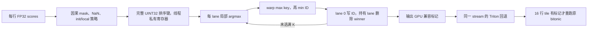
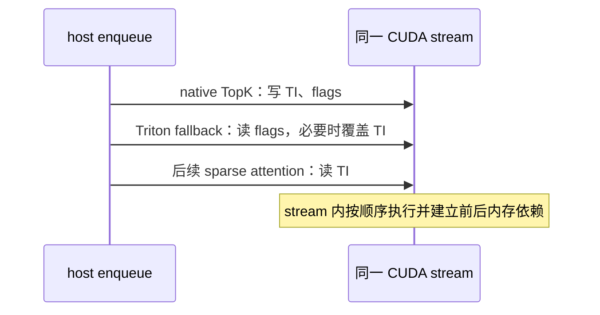

**M3.1 Warp TopK：代码逐段 review 与数值、同步验证**

2026-10-10；review 基线 `8bb59cccd655b900d8125d8b1245e137dd50c221`。本次 host 修复、新增测试和验证证据作为 `feat/minimax_m3.1` 的增量改动交付。行号以本次修复后的 `minimax_prefill_topk.cu` 为准。

结论：新 CUDA 主 kernel 的 FP32 排序键保留完整位信息，独立 CPU oracle、所有非 NaN FP32 位模式的穷举顺序检查和四项 sanitizer 均通过。发现并修复空 tensor 极端 stride 的 host 校验溢出；另外消除 indices-only 分支中未使用 `num_pages` 的隐式窄化。**完整兼容路径仍保留旧 bitonic 对异常分数的历史缺陷，不能将“与旧实现相同”解释成“任意 FP32 输入都满足稳定数学 TopK”。**

**先明确这段代码处理的张量**

本次 M3.1 输入为 `scores[H,Q,N]`，FP32，H=4、N=579、K=16。Q 是当前 chunk 内拼接的 query token 数；batch 由 `cu_seqlens[B+1]` 分段，Q 不是 batch 轴。每个 score 表示一个 query 对一个 128-token KV block 的分数。

给定 batch b 的局部 query q：`position = prefix[b] + q`，`end = position // 128 + 1`。只有 `0 <= block_id < end` 可以参加 TopK。输出 `topk_idx[H,Q,K]` 为 INT32 block ID，不是 score；不足 K 个候选时尾部写 -1。M3 当前只输出 indices，`EmitBT=false`。泛化接口另外支持 K32 与 block table 输出，默认 Python dispatch 的性能范围更窄。

**1. L1–17：依赖、平台和三个常量**

L1 引入 native API 声明。L3–9 引入 CUDA stream、device guard、launch error 检查与 Runtime；`USE_ROCM` 分支不编译 CUDA 实现。L11–13 的 namespace 隔离符号。

L15 `kBlockSize=128` 是 KV block 的 token 数。L16 `kRowsPerCTA=4` 表示每个 CTA 用四个 warp 处理四行。L17 `kFullWarp=0xffffffffu` 表示 collective 中 32 个 lane 全部参加。它成立的前提是活跃行没有 lane 单独退出，下面会检查这一点。

**2. L19–26：score_key，最重要的数值部分**

L21 `__float_as_uint(value)` 读取 FP32 的原始 32 位编码。它不会把 65520.5 转为整数 65520，也不会先缩到 FP16；CUDA 明确将其定义为位重解释。[NVIDIA 类型转换说明](https://docs.nvidia.com/cuda/cuda-math-api/cuda_math_api/group__CUDA__MATH__INTRINSIC__CAST.html)。

L23 `bits & 0x7fffffff` 只去掉符号位，等于零当且仅当输入为 +0 或 -0。L24 把这两种编码统一，因为数值比较认为它们相等。这里必须用 bits 判断：工具链启用了 FTZ，改成浮点 `value == 0` 可能把非零次正规数也当成零。

L25 对负数全部位取反，对非负数翻转符号位，得到按 unsigned 比较的递增顺序。负数原编码方向与数值方向相反，取反修正方向；非负数翻转符号位则把它们放到负数后面。

| FP32 数值 | 原始 bits | UINT32 key |
|---|---|---|
| -Inf | ff800000 | 007fffff |
| -1 | bf800000 | 407fffff |
| 最小负次正规数 | 80000001 | 7ffffffe |
| -0 / +0 | 80000000 / 00000000 | 80000000 |
| 最小正次正规数 | 00000001 | 80000001 |
| +1 | 3f800000 | bf800000 |
| +Inf | 7f800000 | ff800000 |

非 NaN 值的 key 全部大于零，因此 key=0 可以作为“masked / 已移除”的域外标记，连 -Inf 也不会与它混淆。除正负零的语义归一化外，没有丢掉尾数或指数位。NaN 在调用前由 L79–80 按旧契约改成 -1e30；本 helper 不承诺 NaN 的数学排序。

**3. L28–48：模板和参数**

`Capacity` 控制每 lane 的寄存器数组长度，`K` 是输出个数，`EmitBT` 编译时消掉不需要的 BT 分支。N579 使用 Capacity640，每 lane 20 个 key。

L29–35 是输入、输出与 metadata 指针；`__restrict__` 要求写入的输出与其他读写区域不重叠，host 会验证这一点。L36–42 是 INT64 总行数和真实 stride，不能把 M3 chunk view 当成紧凑张量。L43–48 是经过边界检查的 INT32 逻辑尺寸与策略参数。

**4. L49–68：把一个 warp 映射到一行**

L49 `threadIdx.x & 31` 得到 lane；L50 `threadIdx.x >> 5` 得到本 CTA 的 warp 0..3。L51、52 分别取 batch 和 head。L53 `blockIdx.x * 4 + warp` 得到 batch 内局部 query q。

L54–55 读 `cu[b]` 与 `cu[b+1]`。L56–59 检查 segment 起止、整体覆盖、长度不超过 qmax、prefix 非负。它们在 GPU 上检查，错误是异步 device-side assert，不是 host 立即返回错误。

L61–62 的 return 条件只取决于 q、lo、hi，整个 warp 相同，所以退出的是全部 32 个 lane。L63 将 prefix 转成 INT64 后再加 q。L64、65 得到因果可见块数并验证不超过 N。L66 设置 `keep=min(K,end)`，L67 得到当前 block。

L68 用 `head*score_h + (lo+q)*score_q` 找到行。乘法前显式转 INT64，避免先做 INT32 乘法再转宽。对合法 metadata，`lo+q < hi <= total_q <= INT_MAX`，这一处 INT32 加法也不会溢出。

**5. L70–91：一次合并读入，全部保存在私有寄存器**

L71 每个线程声明自己的 `values[Capacity/32]`；不同 lane 不共享这个数组。L75 `idx=j*32+lane`：j=0 时 32 lane 读取列0..31，j=1 时读取32..63，以此类推。ID 可以由 j、lane 恢复，不必在整个选择过程中携带另一个 ID 数组。

L76 默认 key=0。L77 只对同时满足 `idx<n` 和 `idx<end` 的有效因果列读分数。其余列不读 input，也不会被当成有效候选。

L79–80 将 NaN 置为 -1e30。L81–82 将 init 块置为 1e30。L83–84 将 local 块置为 1e29；local 后执行，因此与 init 重叠时 local 覆盖 init。这些是策略性改分，不是原 FP32 排序键精度损失。

L87 检测处理后仍然存在的无穷大，供历史行为回退使用。L88 转 key，L90 写本线程私有数组。有效 score 至多读取一次。

**6. L93–118：每轮先线程内 argmax，再 warp argmax**

L93–94 只用于 BT 排列和 seq_len。L95 保存上一轮 winner，L96 用 `__any_sync` 把异常标记广播成 warp 一致的 bool。

L98 执行 K 轮；外层不完全展开，避免 K16/32 的代码体积扩大。L99、100 将当前 best 初始化为域外 key0 与 INT_MAX ID。L102–107 扫本 lane 的所有 key。只在 `>` 时更新，因此该 lane 内同分保留较小 j，也就是较小 ID。

L109 `__reduce_max_sync(full,best)` 得到整 warp 最大 key；best、winner 都是 UINT32，选择 unsigned overload。L110 只有 local best 等于 winner 的 lane 提交自己的 ID，其他 lane 提交 INT_MAX；warp min 得到最小有效 ID。

例如 lane3 的最佳候选是列67，lane4 的最佳候选是列4，同 key 时第二次 reduction 选列4。它不会只看 lane3/lane4 的线程号，而是比较完整 block ID。

L111–118 是 sm80 以前的 XOR shuffle 回退，两次各五轮。静态逻辑相同；本次机器为 sm_103，没有在更老架构上执行这个分支。SASS 看到实际的 `CREDUX.MAX` 和 `CREDUX.MIN.S32`，结合正负混合输入 oracle 测试核对了 reduction 语义。

**7. L119–137：写一个 winner，然后只在持有它的 lane 删除**

L119–122 对仍需输出的 t 检查 winner 与上一轮是否同 key。降序 TopK 中同分会相邻，因此可以发现 selected 内的 ties。

L123–125 只有 lane0 写 ID，t>=keep 写 -1。虽然仍跑 K 轮，但候选耗尽后产生的 INT_MAX 不会成为有效输出。证明是：每个有效候选 key>0，每轮只删除一个；在 t<keep 时总还有有效候选，winner>0，ID 必然在0..end-1。

L126–131 为可选 BT：当前 block 放到最后一个有效 slot，其余 block 保持选出顺序，页 ID 为 `head*num_pages+idx`。这些计数只有 lane0 读写，不需要 atomic。M3 默认 EmitBT=false，不执行这部分。

L134–136 所有 lane 检查自己持有的隐含 ID，只有 winner 所在 lane 把相应 key 清成0。其他 lane 的私有寄存器不受影响。下一轮每个 lane 只依赖自己清除后的值，其他 lane 没有跨线程内存读取。

**8. L138–154：兼容标记和可选 seq_len**

只有“已选之间同分”还不够：第K名可能与未选出的第K+1名同分，原 bitonic 会选另一组 ID。L145–147 因此检查剩余寄存器中是否仍有与 cutoff 同 key 的候选。

L142 还检查 cutoff<=-1e30。旧实现 masked 列用浮点 -1e30，真实极小分数可能低于这个 sentinel，导致 padding 挤进 TopK。新 native core 的域外 key0 没有这个问题，但兼容路径会请求重跑旧 body。

L143 的 `!has_tie` 是 warp 一致的条件：此前 `__any_sync` 和 winner reductions 都返回全 warp 相同结果，keep 与 t 也一致。因此不存在部分 lane 进入 L147、另一部分跳过的非法 full-mask collective。

L149–150 每行 lane0 写一个 flags[head,totalQ] 标记。L151–153 可选 seq_len：选中了当前块时，前面完整块数乘128，再加当前块有效 token 数；否则是 keep*128。K≤32，所以结果不超过4096。

**9. L157–234：launch、stream 和容量档位**

L170 grid 为 `(ceil(qmax/4), B, H)`，block 为128线程。不同 CTA/warp 写不同输出行。L171 使用输入所在 device 的 PyTorch current CUDA stream，避免把 native kernel 固定发到 default stream。L172–199 在 BT 真/假之间选择编译实例并传入实际 stride；没有用户 shared memory。

L202–234 选择32/128/256/384/512/640/768/1024容量。每个档位都是32的倍数，覆盖 N。较紧的档位减少无效寄存器扫描，尤其避免 N579 被扩成1024。

**10. L236–264：host tensor、布局与别名校验，包含本次修复**

L236–239 保证相关 tensor 在同一 CUDA device、dtype 正确。

L241–249 要求最后一轴连续、query 行不重叠、head 行不重叠。旧代码用 `stride_h >= Q*stride_q`。反例：shape `[0,2,579]`，stride `[2^62,2^62,1]` 不分配数据，但 `2*2^62` 超过 INT64_MAX，校验错误通过。本次改成 `stride_h/stride_q >= Q`，并先要求 `stride_q>=N>=1`；短路求值保证除数正且非零。正数整数条件与原条件等价，不需要溢出乘法。

L251–264 用实际 stride 估计占用地址区间，拒绝 output 与 input/output 别名。空 tensor 直接跳过；合法非空 PyTorch tensor 的 span 受 storage 范围约束。这里是保守区间检测，可能拒绝部分地址交错但实际不碰撞的复杂 view；它不支持任意 stride 排列或伪造 storage。

**11. L269–366：公开 API 的全部边界**

L282–287 检查 FP32 scores、CUDAGuard 和 INT32 metadata/output。L288–294 检查 K16/32、N1..1024、TI shape 及 rows layout。L295–297 检查 contiguous 一维 metadata 与 B/B+1 对应。

L298–302 限制 Q≤INT_MAX、qmax≤INT_MAX-3、H/B≤65535、init/local非负且不超过INT_MAX。qmax 留出3，避免 `qmax+3` 与尾部 query 计算溢出。`prefix+q` 在 INT64 中计算；即使 metadata 很大，end 窄化前的数值也远小于 INT32 上界，并随后通过 GPU `end<=N` 检查。

L303–305 校验 TI 不覆盖输入。L306–325 验证可选 BT/seq_len 的 shape、stride、别名与页号范围。`num_pages>=N`、`H*num_pages<=INT_MAX` 保证最大输出页号 `(H-1)*num_pages+(N-1) <= INT_MAX-1`。

L326 创建GPU flags；L327–328 空行/空head直接返回。L329 对非空输入要求有 segment 和正 qmax。L332 是第二处加固：EmitBT=true 时页数已经检查，再转 int；EmitBT=false 时把未使用参数设为0，不再隐式截断任意 INT64 页数。旧代码这里的窄化不改变 indices，但没有必要保留它。

L333–358 分派K16/32。L359 检查launch错误；这不等同于等待kernel完成，也不立即发现所有 device assert。L360返回GPU flags。ROCm 分支明确拒绝这个native算子。

**12. Python dispatch 与 Triton 回退必须一起 review**

`warp_topk.py:L9–14` 缓存 native export，旧 wheel 缺 export 时可走旧路径。L17–74 限制默认性能替换范围：CUDA、sample_interval1、block128、K16、H4、N512..1024、Q≥1024、indices-only、同一 packed query metadata、相同 mask 契约与 dtype。

L47–50 额外限制 TI 最大元素偏移≤INT_MAX，因为被复用的旧 body 的输出索引使用 INT32。Python 整数本身不会在这个计算中溢出。直接 native API 已通过 >2^31 元素偏移测试，但不能因此放宽完整兼容流程的旧输出索引约束。

`topk_bt_fused.py:L815` 引用原 multirow JIT body。L818–897 的新 fallback 每 tile读取16行 flags，只要其中一行需要兼容，就重跑**整个 tile**，包括该 tile 内没有标记的行。因此并非只重算逐行被标记的行。其余 tile 不读 score。L901–918 在 native 后按同一 current stream 发 fallback。

CUDA 同一 stream 的命令按序执行，因此两个 kernel 之间无需 CPU synchronize；跨 stream 调用则仍需调用者提供 wait/event。本次三条独立非默认 stream 测试、立即释放 flags 后的同 stream allocator 复用，以及 Graph replay 共同验证了当前 runtime 的这条路径。[CUDA stream 执行顺序](https://docs.nvidia.com/cuda/cuda-programming-guide/02-basics/asynchronous-execution.html)。

**同步结论的依据**

CUDA 要求 mask 中所有未退出 lane 用相同 mask 参加同一个 collective；`__reduce_*_sync` 同步参加线程，但不提供内存屏障。[CUDA warp reduction 约束](https://docs.nvidia.com/cuda/archive/12.9.2/cuda-c-programming-guide/index.html#warp-reduce-functions)。

这里不需要额外 `__syncwarp`/`__syncthreads` 的静态依据是：有效行全部32 lane参加；return与包含collective的分支warp一致；跨 lane 信息只通过 reduction/vote/shuffle 传递；候选数组、删除和 BT 计数都是线程私有；不同 warp 写不同 row；后续 kernel 的读取依靠同 stream 顺序。这个结论以合法 metadata、合法 tensor storage，以及调用者不在无依赖的其他 stream 并发修改同一 input/output 为前提。

**和 TopK v3 的 FP32/FP16 问题有什么区别**

对照固定外源快照 `9b8cf23b686a4ca54bbae0dd51a3db9b27fc97ea` 的 `topk_v3.cuh:L65–89`：exact key 同样从 FP32 bits 构建；coarse bin 则先转 FP16，再截取 ordered16 key 的高位。L95–162 处理 bin边界、舍入到偶数、正负零与 FP16 infinity bands，必要时用 exact scan。不能简单断言这版 v3 本身不精确，它已经有保护与精确补救。

新 kernel 没有 coarse histogram、FP16缩窄、浮点 threshold midpoint 或收集 threshold bin 的步骤，因此不依赖那组边界公式。所有 winner 比较使用完整 UINT32 key。仍要审查的数值问题包括 NaN政策、±0归一化、FTZ、unsigned reduction，以及地址/页号整数范围；这些在本次单独验证。

本方法是小K重复argmax加warp reduction；CUDA primitive参考官方定义，packed-row、因果、输出与历史等分行为来自本仓原 kernel。DeepSelect和v3是性能/算法对照，不应把它们的精度承诺直接移植到这个实现。

**保留的历史语义风险：数学 oracle 与兼容 oracle 分开看**

`flash_with_topk_idx.py:L304–329` 的旧 comparator 用 `sum(y*mask)` 抽取左右元素。Infinity乘0会产生NaN；masked列的 -1e30还会压过更低的有效分数。新 core 检测这些情况并请求回退，完整兼容路径于是保留原结果。

本次 N579/H4/K16 的独立对照：

| 输入 | native stable oracle | 完整流程与旧实现 | 旧结果的限制 |
|---|---|---|---|
| 相邻ULP、唯一正负次正规数、最小normal边界、正最大有限值、FP16 overflow附近 | 完全一致 | 完全一致 | 这些case未触发回退 |
| ±0全等分 | 完全一致 | 完全一致 | 旧ID顺序非稳定；选任意同分ID仍是数学TopK |
| 正负Inf混合 | 完全一致 | 完全一致 | 旧输出包含-1，并选出有限分数，违反该输入的数学TopK |
| 全NaN按-1e30处理 | 完全一致 | 完全一致 | 旧输出全-1，虽然按NaN契约存在579个候选 |
| 有效值全部低于-1e30 / 接近负FLT_MAX | 完全一致 | 完全一致 | 旧padding挤入TopK，输出全-1 |

例如负最大有限值附近的一行，新 core 返回 `[578,577,...,563]`，旧实现及完整兼容结果为16个-1。Inf混合时 native 返回 `[0,4,...,60]`，旧结果包括 `[564,565,-1,-1,...]`。这些是确认的历史问题，不是 bitcast 导致的数值截断。本次保留此前要求的兼容策略；若要对这些异常输入也承诺严格数学TopK，应单独调整回退策略和异常分数契约。

**本次验证与原始证据**

azk112物理GPU1，Runtime10.3/148SM，CUDA13.2、GCC12、PyTorch2.11+cu130，`sm_103/-ftz=true`。启动前及各GPU测试阶段重新采样完整5秒，记录在artifact中；未停止其他任务。

| 验证 | 结果和范围 |
|---|---|
| 实际生产score_key穷举 | 4,278,190,082个非NaN FP32编码，分块扫描；正数key严格递增、负数严格递减，跨chunk边界也检查，±0相同；含±Inf |
| 独立CPU IEEE oracle与风险交叉 | 最终9方法、473个计数子用例，另含3个页号越界拒绝检查，零skip、全部通过 |
| 原有回归 | 1670 GPU正向子用例与6个CPU dispatch方法通过 |
| 真实大指针偏移 | head/query各1例，score与TI偏移>2^31元素，实际分配约16GiB以上，输出与CPU oracle一致 |
| 非默认stream | 三条独立stream共72轮对照；producer→native→fallback→clone，flags释放/allocator复用，无中间host同步 |
| Graph动态metadata+flags | K16/32、indices/BT交叉，共128次replay，更新cu/prefix/score模式，匹配旧实现 |
| GPU非法metadata | 6个独立进程/context，负prefix、INT_MAX prefix、cu起止错误、不单调、qmax不足均触发预期device assert |
| memcheck | 462个子用例，0 errors |
| synccheck | 462个子用例，0 errors |
| racecheck | 462个子用例，0 hazards / 0 warnings |
| initcheck | 462个子用例，0 errors |

473这个计数包含成功的host拒绝检查，不应称为473个纯正向GPU case。四项sanitizer没有运行2个约17GiB大stride分配case；这2例在普通运行中单独通过。新增的9个scalar边界case在最终普通运行验证，没有重复跑sanitizer；它们检查的是host拒绝/空tensor返回。sanitizer主要覆盖设备代码；racecheck结果不能独立证明所有global memory竞争都不存在。

[验证摘要](review_20261010/review_summary.json)、[最终交叉结果](review_20261010/final_adversarial.json)、[穷举结果](review_20261010/exhaustive_keys.json)、[原有回归](review_20261010/original_regression.json)、[memcheck](review_20261010/memcheck.log)、[synccheck](review_20261010/synccheck.log)、[racecheck](review_20261010/racecheck.log)、[initcheck](review_20261010/initcheck.log)。原始score/ID极值对照保存在JSON的 `legacy_findings` 字段。

最终生产CUDA源SHA256：`5ce49e76eb3d3c3f6e2432d009f8b80607afaee4abdb8a7b23222057da8bc79b`。修复前、修复后与最终格式化后的全部SASS逐字一致，SHA256 `6dbf00552c79d8fa48ed61ade72354c78feafeb9026573d1e53a6b531545b1d8`；两处修改只影响host。此次没有重新测模型端到端性能；原报告性能来自此前A/B，不属于本次新测结果。

本次focused extension直接include并编译生产CUDA translation unit，测试probe调用其中真实helper，没有重写一份近似算法。完整Bazel/wheel、其他GPU架构、任意输入组合仍未由这些测试穷尽。azk112、azk114任务测试容器已经停止，核验本任务PID和GPU allocation连续超过5秒均释放。

**复现方式**

新增常规测试：在构建了native export的环境运行 `test_prefill_topk_adversarial.py`；`M31_TOPK_LARGE_STRIDE=1`启用真实大stride用例。没有该export时，不应把跳过或mock视为GPU验证成功。

focused复现包的 `setup.py`、`key_probe.cu`、`key_binding.cpp`、`check_keys.py`、`run_review.py`、`run_original.py`、`negative_metadata.py`、`run_sanitizers.sh` 已随此目录保存。runner默认工作目录为自身目录，并要求 `source/rtp_llm/...` 有本次生产CUDA/header及sparse_msa源码；新环境先将仓库对应文件复制到该结构，按GPU选择skill完成gate，再build和run。`review_env.sh`及sanitizer脚本中的host/container/data路径为本次环境，换环境需要相应改路径。完整可运行目录与build、SASS、gate、清理日志保存在交付artifact `outputs/kernel_review_20261010`。
