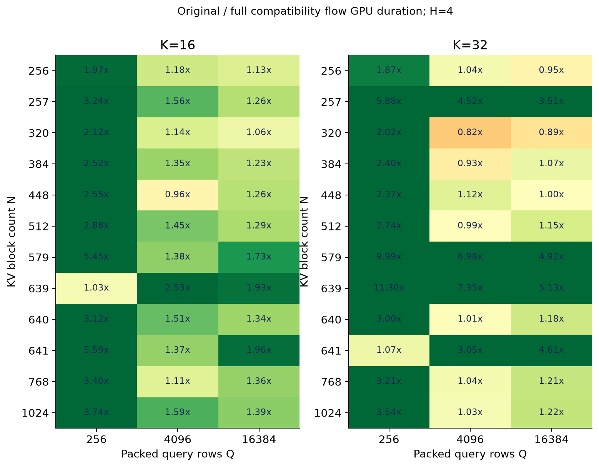
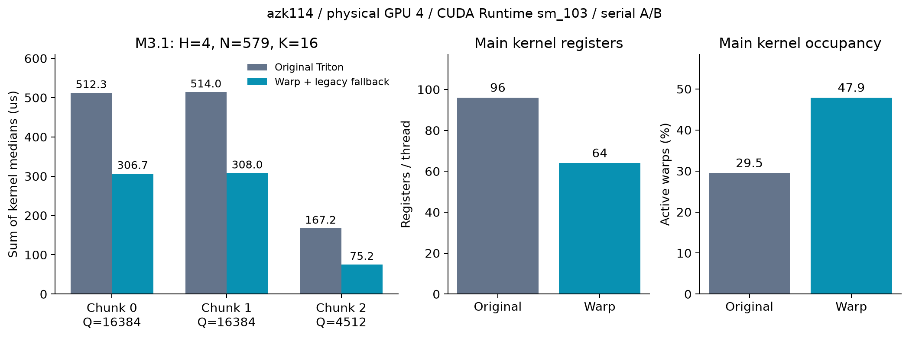
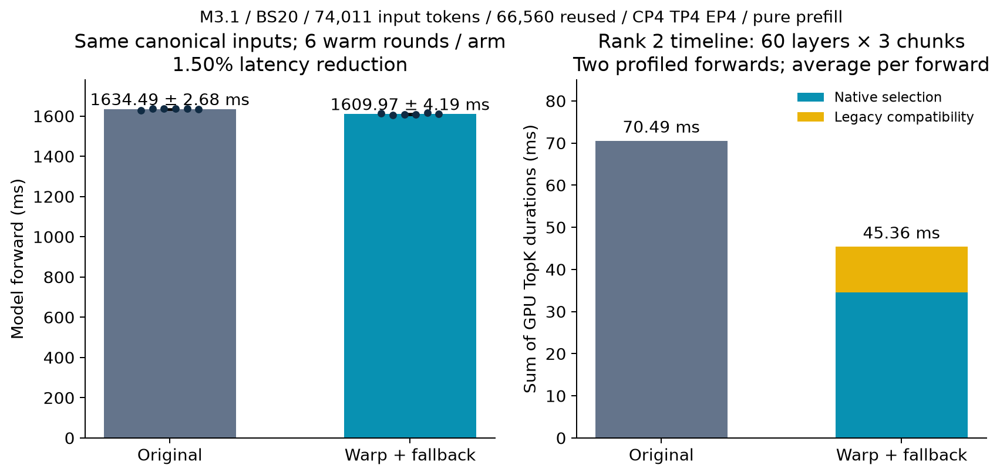

# M3.1 prefill TopK 优化报告

2026-10-10；基于外源 `feat/minimax_m3.1` 的 `208f1d2f3ff6c745652a9b0a60bbcdfbf6bf0833`，提交分支 `perf/m31-prefill-warp-topk`。

最终兼容版：同规格三段单算子 **1193.510 → 689.796 μs，快 1.73 倍，耗时减少 42.20%**；真实 M3.1 纯 prefill 的 model-forward **1634.49 → 1609.97 ms，减少 24.52 ms（1.50%）**。140/140 个对应请求首 token 一致，35,788,800 行真实 score 的 TopK block ID、顺序均与原实现一致。以下性能均包含等分兼容回退 kernel。

## 规格与复现

TopK 位于每个 MSA 层的索引分支：index QK → 128-token KV block 的最大 score → TopK → 稀疏注意力。它与 MoE 专家路由 Top4、输出采样 Top1 分属不同位置。

| 项目 | 本次 M3.1 规格 |
|---|---|
| 输入 | FP32 scores[H,Q,N]，H=4、N=579；Q 是 packed query token 行数，batch 分段由 cu_seqlens 表示 |
| 输出 | INT32 indices[4,Q,16]，短行补 -1；只输出 indices，EMIT_BLOCK_TABLE=False |
| 有效候选 | block_id ∈ [0, floor((prefix+query_position+128)/128))；init=0、local=1，当前块 score 置为 1e29 |
| 请求 | BS20；每请求输入 74,011、复用 66,560（89.93%）、新增 7,451；输出 1 token |
| 并行与切块 | CP4/TP4/EP4/DP1；每 rank Q=37,280（含 CP 分片 padding），分为 16,384 / 16,384 / 4,512；60 层、每层三段 |
| 内存布局 | indices head stride 保留完整 37,280 行；tail score head stride 保留 16,384 行，不能按紧凑 tensor 假设 |

原附件 rank 2 大段中位数约 511/513 μs，约 580 μs 为较高样本；本次基线单算子约 512/514 μs、整模型 timeline 约 510/512 μs，稳定性能与原规格接近。已检查用户提供的内源 perf commit `64823ab765733a17c82cad2a93307caf7379822b`，保持附件 BS20 场景，未混入最新 BS60 target。

权重来自 azk111 `/data0/ruixuan.zrx/MiniMax-M3.1-preview2-dspark`，实际使用共享副本 `/mnt/hf3fs/3fs/models/MiniMax-M3.1-preview2-dspark`。101 个 payload 文件 SHA256 一致，包含 79 个 safetensors、252,418,384,434 bytes。

## 方法与执行过程

原 kernel 对窗口做 bitonic 排序并与已有 TopK 合并；K=16 时窗口为 32 列。新主 kernel 为一个 CTA 128 threads、四个 warp，每个 warp 独立处理一个 (head, query) 行：

1. lane l 合并读取 l、l+32、l+64…，只读取因果可见候选。N=579 分派 Capacity=640，每 lane 保存 20 个 UINT32 key，索引隐含在 lane+32*j 中。
2. FP32 转为保持数值顺序的整数 key：负数取反，非负数翻转符号位；统一正负零，保留非零 subnormal 和全部 score 位。NaN/初始化块/局部块处理沿用原契约。
3. 重复 16 次：每 lane 求寄存器局部最大值，`__reduce_max_sync` 求 warp 最大 key，`__reduce_min_sync` 选最小 ID；lane 0 直接写 M3 indices view，winner 的持有 lane 清除 key。完整 warp 参与 reduction，不需要 CTA barrier 或用户 shared memory。
4. 同时输出 GPU 行标记：已选值等分、cutoff 等分、有效 infinity，或 cutoff 可受原 -1e30 mask sentinel 影响。第二个 Triton kernel 每 tile 读取 16 个标记，存在标记才执行**未经修改的原 bitonic JIT body**并覆盖该 tile 的结果；其余 tile 直接返回。没有 CPU 判定或同步，Graph replay 读取当次 score/metadata/标记。

收益来自小 K 重复 argmax 减少排序交换、隐含 ID 降低寄存器占用、warp 内整数 reduction、直接按原布局输出。Capacity 按 32/128/256/384/512/640/768/1024 分档，避免边界 shape 空扫描过多。等分回退是最终实现的一部分：单纯“等分优先小 ID”的原型会改变历史 block 选择及模型首 token，review 后已修复；最终完整流程包含两个 kernel。

整数 reduction 参考 [NVIDIA PTX redux.sync](https://docs.nvidia.com/cuda/parallel-thread-execution/index.html#parallel-synchronization-and-communication-instructions-redux-sync)，原 packed-row、因果、输出和等分语义来自本仓 M3 kernel。DeepSelect/RTP radix 用于性能对照；本实现采用上述重复 argmax 方法。

## 单算子 benchmark 与 shape

azk114 物理 GPU4，同卡串行；Runtime CC10.3、148 SM，编译 sm_103（NVML 的 8.9 与 Runtime 冲突，未采用）。CUDA13.2/GCC12/PyTorch2.11.0+cu130。每点固定随机种子，5 次预热、30 次计时；256 MiB 缓存清理位于计时区间外。下表为算子各 kernel 耗时中位数之和，CUDA event 数据另见 CSV。

| H/Q/N/K | 原实现 μs | Warp 完整流程 μs | 加速比 |
|---|---:|---:|---:|
| 4/16384/579/16，chunk 0 | 512.338 | 306.658 | 1.67× |
| 4/16384/579/16，chunk 1 | 514.019 | 307.954 | 1.67× |
| 4/4512/579/16，chunk 2 | 167.153 | 75.184 | 2.22× |
| 三段合计 | 1193.510 | 689.796 | 1.73× |

107 个 shape、214 条实现记录全部通过选值/范围/唯一性/padding 校验。覆盖目标三段；N=32/128/256/579/1024、Q=1/32/256/4096/16384、K16/32；以及 N=257/320/384/448/512/639/640/641/768 的容量边界。

默认替换范围收敛为 **H=4、K=16、512≤N≤1024、Q≥1024、indices-only**，测量的 17 个点均更快，最小 kernel 加速比 1.115×（N768/Q4096）；CUDA event 最小 1.106×。K32、小 Q、较小 N 存在回退点，例如 N384/Q4096/K32 为 95.232→102.289 μs，因此这些范围保留原路径。可用 `M3_PREFILL_TOPK_IMPL=bitonic` 回退；旧 wheel 缺少 export、其他 mask/sample/block/metadata 契约亦走原路径。完整结果见 [CSV](minimax_m31_prefill_topk/shape_results.csv) 和交付目录的交互 HTML。

此前 azk115 GPU0 的独立比较固定 RTP `feat/glm5_cu13_rebase` commit `9b8cf23b686a4ca54bbae0dd51a3db9b27fc97ea` 和 [DeepSelect bfa4507](https://github.com/deepseek-ai/DeepSelect/blob/bfa4507d935f17ebfc3d0f00ff7d3c9a4d0e5c18/deep_select/interface.py)。同目标大段 RTP v3 core/M3 适配全流程为 721.35/798.68 μs，DeepSelect 官方为 1381.37/1458.49 μs、256-thread 调参为 684.93/762.02 μs（579 列 pad 到 768）。这些适配检查数学 TopK，没有保留原 bitonic 等分 ID 的承诺；属于另一台卡的研究对照，不与最终兼容版混合计算加速比。

## NCU profiling

NCU2026.1.1 full metrics，预热后的目标 chunk 0；原 kernel 和新流程两个 kernel 各 40 次 replay，与整模型计时分开。

| 指标 | 原 bitonic | 新 warp 主 kernel | 等分回退 kernel |
|---|---:|---:|---:|
| GPU duration | 511.424 μs | 253.536 μs | 58.464 μs |
| registers/thread | 96 | 64 | 96 |
| achieved occupancy | 29.50% | 47.88% | 23.22% |
| register-limited blocks/SM | 5 | 8 | 5 |
| executed instructions | 429,026,768 | 168,490,215 | 797,080 |
| shared load/store instructions | 32,768 / 66,368 | 0 / 0 | 8 / 16 |
| user dynamic shared memory/CTA | 1,024 B | 0 B | 1,024 B |
| driver shared memory/CTA | 1,024 B | 1,024 B | 1,024 B |
| DRAM read/write | 150.601 / 5.111 MB | 150.549 / 5.769 MB | 0.365 / 0 MB |
| barrier stall / active issue ratio | 0.1672 | 0 | 0.0250 |

完整流程 GPU 时长 **312.000 μs**，主 kernel 的 253.536 μs 不能单独当作最终算子耗时。两 kernel 指令合计 169,287,295，比原实现减少 **60.54%**；主 kernel 寄存器减少 33.33%，occupancy 提高。DRAM 读量基本相同，写量包含新增行标记，收益主要来自计算及调度。目标 native cubin stack/spill/barrier 为零；兼容回退保留原 kernel 的 shared/barrier 资源。[指标摘要](minimax_m31_prefill_topk/ncu_summary.json)；完整 NCU reports/CSV/txt 在交付目录。

## 实际 M3.1 timeline 与端到端贡献

azk114 GPU0–3，纯 prefill，CP4/TP4/EP4，Graph 关闭。冻结原模型运行包及数学 backend，增加相同生产 CUDA translation unit 的 focused extension 和 TopK 分派；两实现只切换 `M3_PREFILL_TOPK_IMPL`。新服务各自 seed 共同 prefix，每轮新 suffix；phase_base=800 的对应 canonical protobuf/token 输入一致。每组实际一次 BS20 执行 149,020 新 token，每实现冷一组加六轮稳定组；主统计使用六轮稳定组、120 请求，排除 profiler/audit/编译时间。

| 耗时口径 | 原实现 | Warp 完整流程 | 节省 |
|---|---:|---:|---:|
| model-forward，均值 ± 样本标准差 | 1634.49 ± 2.68 ms | 1609.97 ± 4.19 ms | 24.52 ms（1.50%） |
| server prefill：first_token_cost_time − wait_time | 1639.42 ms | 1614.48 ms | 24.94 ms |
| RPC TTFT：每轮请求中位数的六轮均值 | 1659.04 ms | 1633.81 ms | 25.23 ms |
| rank2 TopK GPU duration 总和/forward | 70.494 ms | 45.358 ms | 25.136 ms |

四 rank 各保存两个完整 profiled forward。原版每 rank 360 次 bitonic；新版 360 次 native + 360 次兼容回退，零旧 multirow 根 kernel 调用。rank2 每 forward 的 native/回退合计为 34.510+10.848=45.358 ms；大段 median 为 250.993/251.074 μs，回退约 63.905/63.984 μs；tail 为 71.392+49.600 μs。TopK 总和减少 25.136 ms，与 model-forward 减少 24.521 ms 接近，但不是对所有差值的严格因果归因；四个并行 rank 的时长不能相加当作端到端收益。[timeline 摘要](minimax_m31_prefill_topk/timeline_summary.json)、[主统计](minimax_m31_prefill_topk/e2e_summary.json)。

这是实际权重、合成 token 输入、无 PD transfer、无 memory/remote reuse、输出 1 token 的纯 prefill 端到端结果；未覆盖完整 P/D 传输、多 token decode 或生产质量数据集。

## Review 与验证

GPU **10 个方法、1670 个正向交叉子用例、15 个非法 host 参数用例，零 skip**；CPU 6 个 dispatch 方法通过。覆盖 H1/2/4/8、K16/32、N1..1024 的 32 个代表值/边界、连续与 padded stride、indices/BT/seq_lens、短行、9 类分布与 init/local 交叉、NaN/Inf/±0/subnormal、空输入、非默认 stream、Graph 动态 score/prefix/cu，以及等分标记和复用原 body 的精确 ID/BT/SL 对照。

Compute Sanitizer memcheck 160 个正向子用例、synccheck 152 个，均 0 errors。Review 修复 FTZ 下零判断（按 bits 判断，避免把 subnormal 当零）、别名与 stride、int64 指针偏移和 legacy int32 输出范围、页 ID 溢出、Graph metadata、容量档位、等分/Inf/-1e30 sentinel 兼容。原 bitonic body AST 未改；新代码通过 clang-format、Black、isort、diff whitespace 检查。[测试摘要](minimax_m31_prefill_topk/cross_tests.json)。

额外真实 score audit：四 rank×180 次调用，**35,788,800 行的 ordered IDs、集合和选值差异全部为 0**，对应 A/B 冷+六轮 warm 的 **140/140 首 token 一致**。Audit 单独运行，未计入性能数据。[audit 摘要](minimax_m31_prefill_topk/real_score_audit_summary.json)。

完整 Bazel/wheel 构建在 `rules_python` 依赖获取时被容器 SSH host-key verification 阻塞。已完成相同生产 CUDA 源的 focused 编译、thin pybind、交叉测试、sanitizer、NCU 和实际模型 A/B；完整 wheel/全仓 CI 尚未验证，需正常构建环境补齐。

## 交付与复现

代码、报告、图和精简 JSON/CSV 提交实验分支；构建/测试/benchmark/NCU/模型运行脚本见 [复现说明](minimax_m31_prefill_topk/reproduction.md)。交付 artifact 包含四 rank 新旧 timeline、完整 NCU reports、107 点数据、请求 protobuf/hash、日志、权重 SHA、audit 和 GPU gate/清理证据。原型和中间结果保存在历史目录，不作为最终性能口径。

任务创建的模型服务和 GPU 测试容器已全部关闭；核验本任务 PID、端口、GPU allocations 连续超过 5 秒均已释放，保留权重、缓存及结果。
